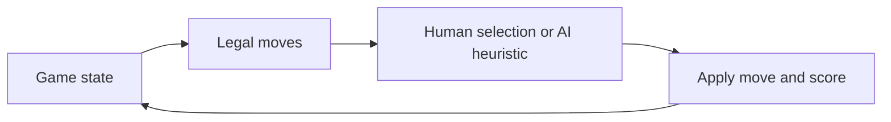

# Peskaç

**An offline four-player card game with contract-aware computer opponents.**

Play one human against three computer players across five contracts: Kupat, Çupat, Derri, Duart and Shtatat. The Electron interface includes legal-card highlighting, cumulative scoring, a game log and an explanation of the implemented rules.


## Algorithmic focus

The computer players use heuristics that change with the contract: card counting, inference about void suits, penalty avoidance and suit-management decisions. Their decision interface is based on the player's hand and observable game information. This is a heuristic game-playing project, without a claim of optimal play or a measured win-rate benchmark.



## Run

Install Node.js and npm, then run from this folder:

```bash
npm ci
npm start
```

Electron opens a desktop window. The game does not require an account or an online backend.

## Tests

```bash
npm test
```

The tests use Node's built-in test runner. Electron is needed for the desktop interface, not for the game-rule tests.

## Code guide

| File | Responsibility |
| --- | --- |
| `src/game.js` | Cards, legal moves, contracts and scoring |
| `src/ai.js` | Contract-specific computer-player decisions |
| `src/app.js` | Interface and game interaction |
| `main.js` | Electron window |
| `tests/game.test.js` | Rule and gameplay checks |

See [implemented house rules](RULES.md). Rules can vary between players and regions; this document records the behavior implemented here. Cross-platform support comes from Electron; platform-specific release packages are not included.
